<div align="center">


### 🥽 Put on the headset, grab the wheel — and try not to hit anyone.


</div>

---

## 📌 At a glance

> A **VR driver-training simulator** built in Unity at THD. The driver sits in a **Meta Quest 3** headset with a real **racing wheel and pedals**, and drives through a living city — buses, traffic and **AI pedestrians** who cross, jog and wander. Day, night, fog and rain change what the driver can see; **emergency braking (AEB) and ABS** step in; every crash is detected and the **driver's reaction time is logged**.

### 🎬 Watch the full run (3 min)

https://github.com/user-attachments/assets/f582defd-e9c4-494e-8dcd-7efc9e3e9b1d

<sub>City fly-through, day and night → Level 1 → Level 2 → Level 3 → mission complete → what happens if you hit a pedestrian. Can't see the player? [Download the video](media/vr-full-demo.mp4).</sub>

| 🗓️ Built | 👥 Team | 🧠 My role | 🎮 Setup |
|:---:|:---:|:---:|:---:|
| 2024 – 2025 | 7 students | **Team lead** · pedestrian & traffic system | Meta Quest 3 · HORI racing wheel & pedals |

---

## 📑 Contents

- [What the driver experiences](#-what-the-driver-experiences)
- [Hands on the wheel](#-hands-on-the-wheel)
- [The mission: three levels](#-the-mission-three-levels)
- [How it works](#-how-it-works)
- [My part: pedestrians & traffic](#-my-part-pedestrians--traffic)
- [Code](#-code)
- [Gallery](#-gallery)
- [Project paper](#-project-paper)
- [What I learned](#-what-i-learned)

---

## 🚗 What the driver experiences

<table>
<tr>
<td width="33%" align="center" valign="top">

### 🌦️ Changing conditions
**Day, night, fog and rain** — each one changes visibility and how early hazards appear.

</td>
<td width="33%" align="center" valign="top">

### 🚶 A living city
AI **pedestrians** walk, jog and cross; **buses and cars** follow traffic routes.

</td>
<td width="33%" align="center" valign="top">

### 🛑 Active safety
**Automatic emergency braking** and **ABS** are simulated in the vehicle.

</td>
</tr>
<tr>
<td width="33%" align="center" valign="top">

### 💥 Crash detection
Collisions end the run and the **reaction time is logged** for review.

</td>
<td width="33%" align="center" valign="top">

### 🎮 Real controls
A **HORI racing wheel and pedals**; **IK-rigged hands** follow the wheel in VR.

</td>
<td width="33%" align="center" valign="top">

### 🧭 Guided missions
Glowing checkpoint arches and on-screen goals show where to drive.

</td>
</tr>
</table>

---

## 🖐️ Hands on the wheel

The driver's **virtual hands are rigged with inverse kinematics** and follow the real **HORI racing wheel** — turn the wheel in the room and you see your hands turn it in VR.

<div align="center">
  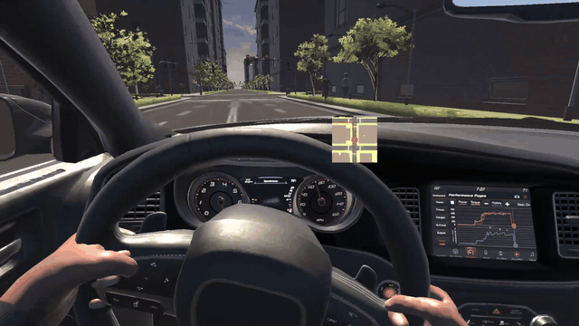
  <br/><sub><i>IK-rigged hands following the real steering wheel</i></sub>
</div>

---

## 🏁 The mission: three levels

A passenger-taxi mission across the city — each level gives a new goal on screen, and a glowing **checkpoint arch** shows where to go.

<div align="center">
  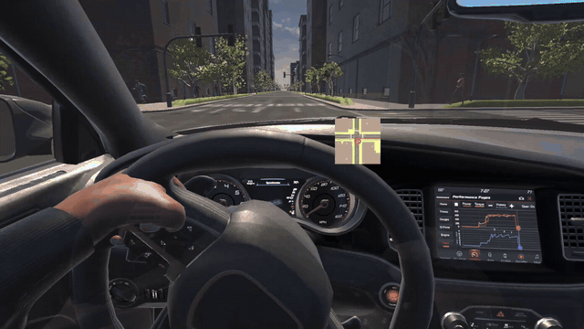
  <br/><sub><i>Level 1 starts — drive to the glowing arch to pick up the passenger</i></sub>
</div>

<br/>

<table>
<tr>
<td width="33%" align="center" valign="top">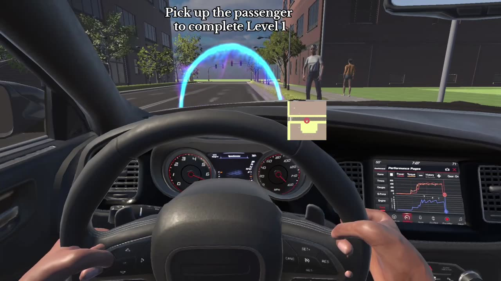<br/><b>Level 1</b><br/><sub>Pick up the passenger</sub></td>
<td width="33%" align="center" valign="top">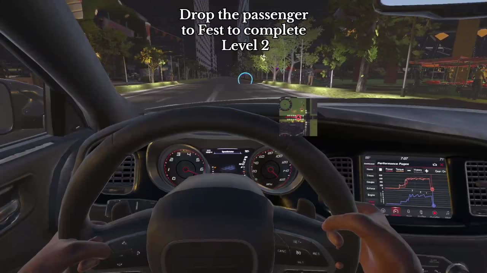<br/><b>Level 2</b><br/><sub>Drop the passenger at the fest</sub></td>
<td width="33%" align="center" valign="top">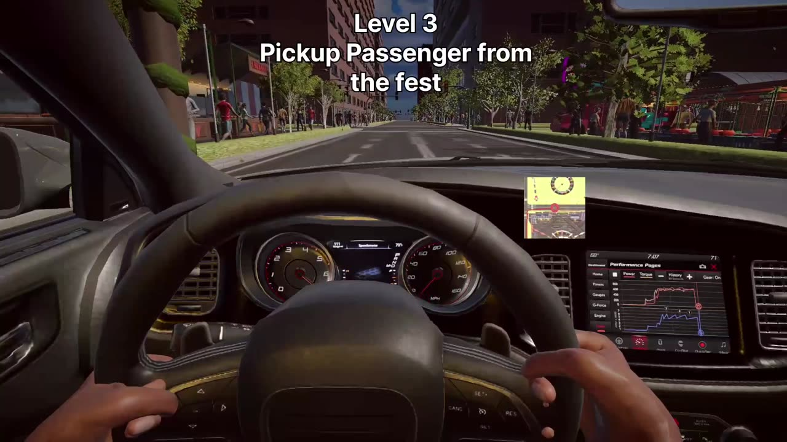<br/><b>Level 3</b><br/><sub>Pick up from the fest, drive them home</sub></td>
</tr>
<tr>
<td width="33%" align="center" valign="top">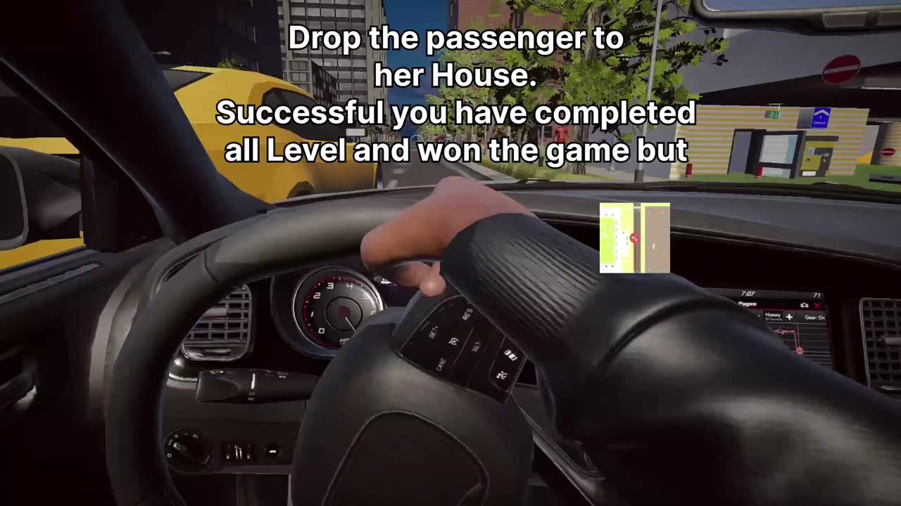<br/><b>🏆 Mission complete</b><br/><sub>All levels done</sub></td>
<td width="33%" align="center" valign="top">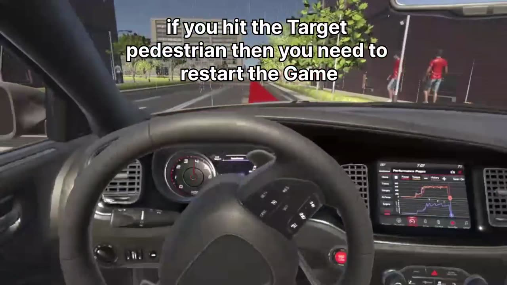<br/><b>⚠️ The twist</b><br/><sub>Hit the target pedestrian and you must restart</sub></td>
<td width="33%" align="center" valign="top">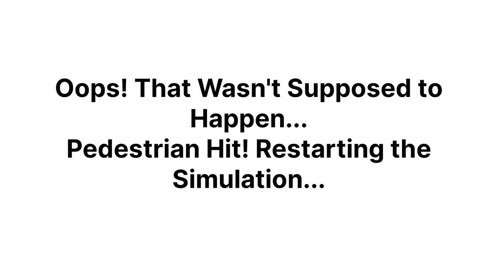<br/><b>💥 Crash detected</b><br/><sub>The simulation restarts</sub></td>
</tr>
</table>

---

## 🔄 How it works

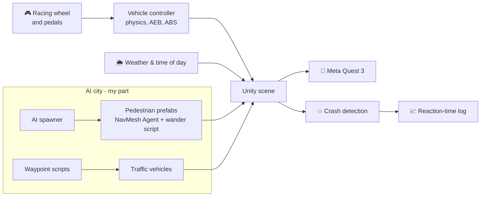

---

## 🧑‍💻 My part: pedestrians & traffic

I led the seven-person team and built the **pedestrian and traffic system** end to end:

1. **Characters** — Mixamo humanoids with walk, jog and run animations
2. **Walkable areas** — footpaths baked as the **only walkable surface** with NavMesh Surface and NavMesh Modifier, so pedestrians never step onto the road by accident
3. **AI spawner** — clones pedestrian prefabs across the city within a set radius
4. **Wandering** — every pedestrian has a **NavMesh Agent** and a wander script that keeps picking new random destinations on the footpaths
5. **Traffic** — waypoint scripts drive buses and cars along their routes

---

## 💻 Code

[`NPCWander.cs`](Unity_NavMesh_AI_Walk/Assets/Scripts/NPCWander.cs) — picks a random reachable point on the NavMesh and walks there, again and again:

```csharp
void Update() {
    timer += Time.deltaTime;
    if (!agent.pathPending && agent.remainingDistance <= agent.stoppingDistance
        && timer >= wanderTimer) {
        agent.SetDestination(GetRandomNavMeshPoint(transform.position, wanderRadius));
        timer = 0f;
    }
}

Vector3 GetRandomNavMeshPoint(Vector3 center, float radius) {
    Vector3 randDir = Random.insideUnitSphere * radius + center;
    return NavMesh.SamplePosition(randDir, out NavMeshHit hit, radius, NavMesh.AllAreas)
        ? hit.position : center;   // only points on the walkable footpath
}
```

[`NavMeshVisualizer.cs`](Unity_NavMesh_AI_Walk/Assets/Scripts/NavMeshVisualizer.cs) — shows the baked NavMesh in the editor while tuning the footpaths.

<details>
<summary><b>▶ Use the wander script in your own scene</b></summary>

1. Bake a **NavMesh** — mark footpaths walkable and roads not walkable (NavMesh Modifier)
2. Add a **NavMesh Agent** and `NPCWander` to a character prefab
3. Set `wanderRadius` (how far a pedestrian roams) and `wanderTimer` (pause between targets)
4. Spawn several prefabs — each one wanders on its own

</details>

---

## 📸 Gallery

<table>
<tr>
<td width="50%">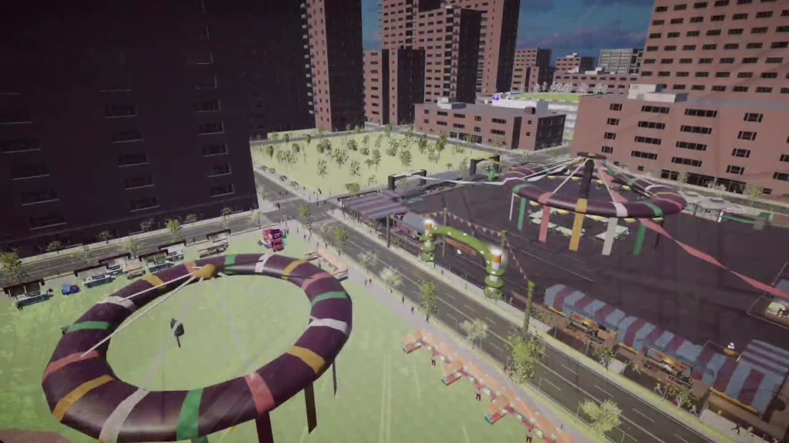</td>
<td width="50%">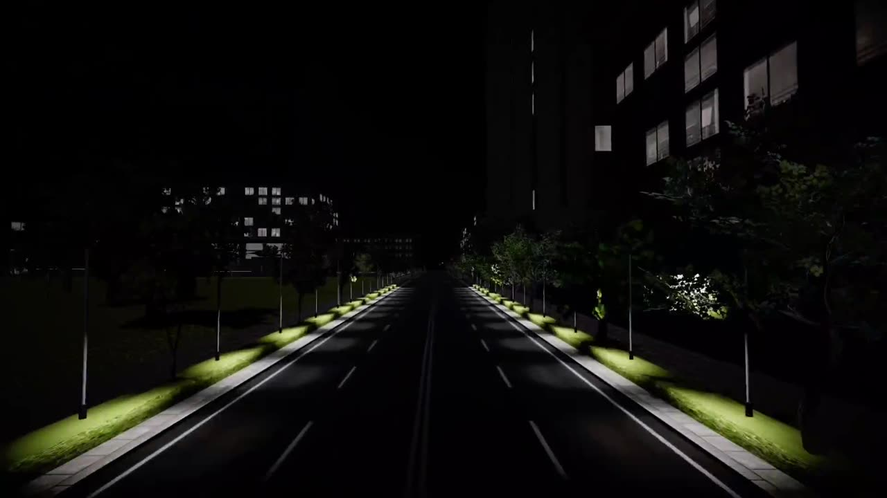</td>
</tr>
<tr>
<td align="center"><sub><b>The city</b> — fest ground, roads and buildings</sub></td>
<td align="center"><sub><b>Night</b> — street lights and low visibility</sub></td>
</tr>
<tr>
<td width="50%">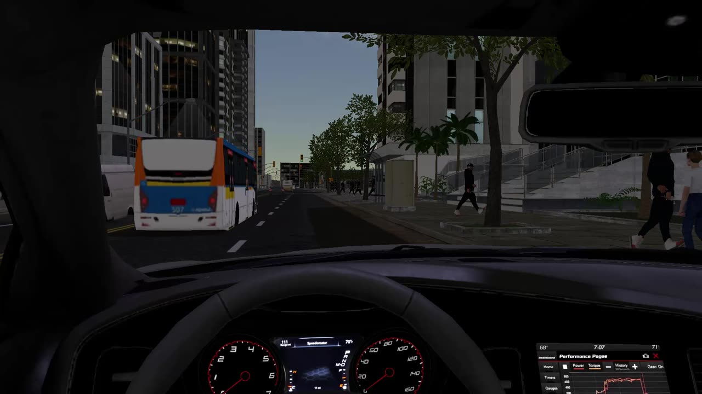</td>
<td width="50%">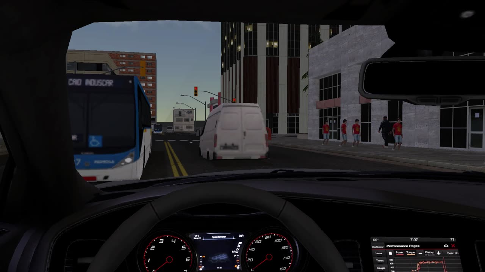</td>
</tr>
<tr>
<td align="center"><sub><b>City drive</b> — bus ahead, pedestrians crossing</sub></td>
<td align="center"><sub><b>Crowds</b> — AI pedestrians on the footpaths</sub></td>
</tr>
<tr>
<td width="50%">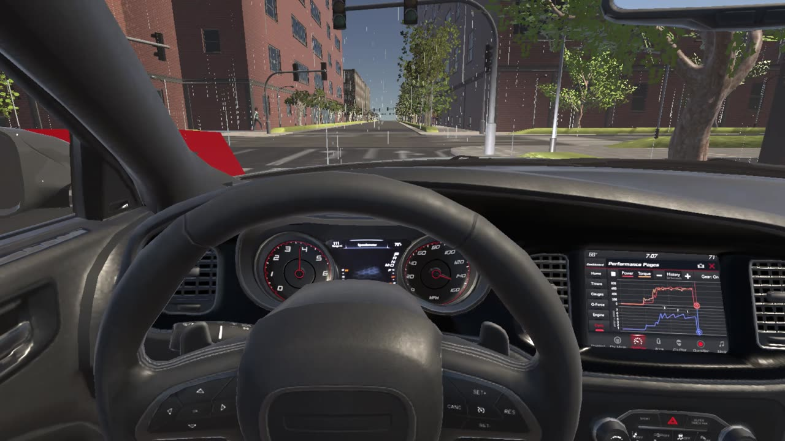</td>
<td width="50%">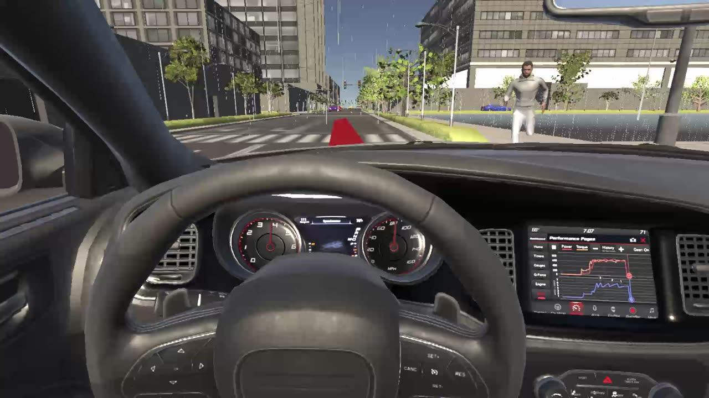</td>
</tr>
<tr>
<td align="center"><sub><b>Rain</b> — reduced visibility</sub></td>
<td align="center"><sub><b>Guide path</b> — a jogger steps out ahead</sub></td>
</tr>
</table>


---

## 📄 Project paper

*Driver Perspective Active Safety System: A Multi-Level Simulation in Virtual World Using Unity for Developing Safe Driving* — course project paper (IEEE format), Deggendorf Institute of Technology, 2025.
I wrote the **Introduction** and the section on **implementing pedestrians and the traffic system**.

📕 [Read the paper (PDF)](CVAR%20Paper%2022402834%2022401580%2022401917%2022408646%2022405975%2012300527%2022203798%20(1).pdf)

---

## 🧠 What I learned

- 👥 **Leading a team of seven** — splitting a large Unity project into parts and integrating them
- 🧭 **AI navigation** — NavMesh baking, agents and spawning for believable crowds
- 🥽 **VR development** — performance, comfort and real input hardware on Meta Quest 3
- 🛑 **Safety thinking** — designing scenarios that test a driver's reactions

---

<div align="center">

### 👋 Built by **Ajay Arjun Mannolkar** and team
M.Sc. Mechatronics & Cyber-Physical Systems · THD Deggendorf

[](https://technolkar.github.io)
[](https://www.linkedin.com/in/ajaymannolkar)
[](https://www.youtube.com/@TechnolkarInnovations)

⭐ *If you enjoyed the ride, give the repo a star!*


</div>
